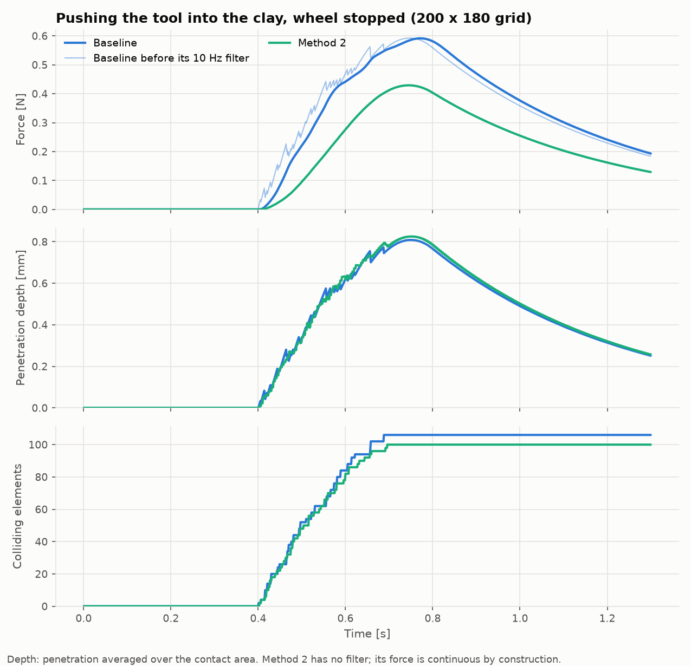
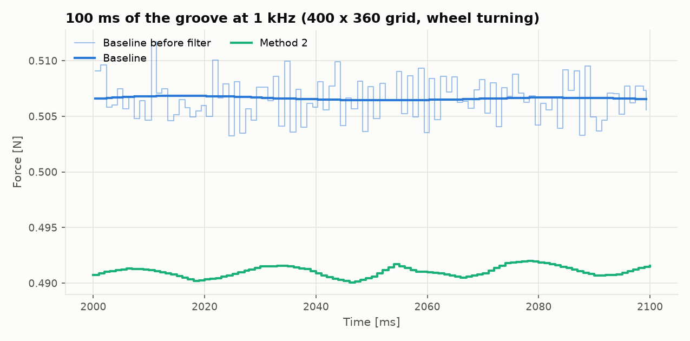
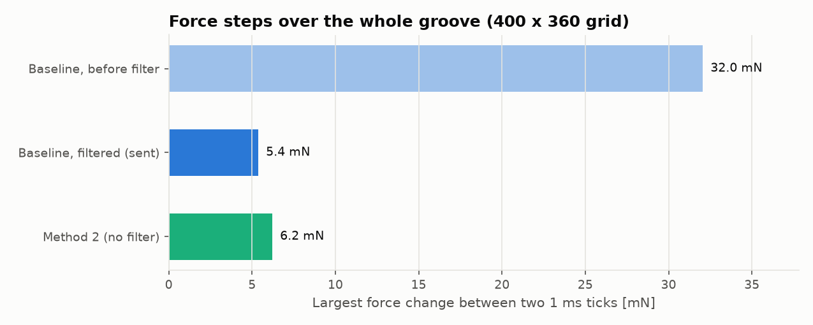
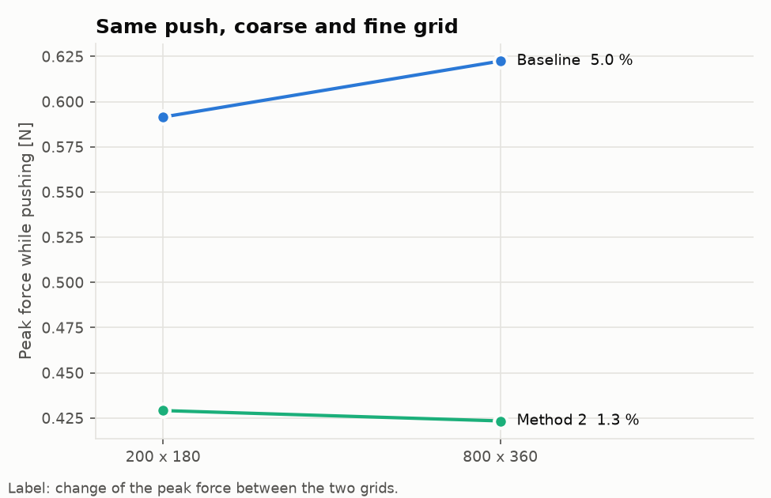
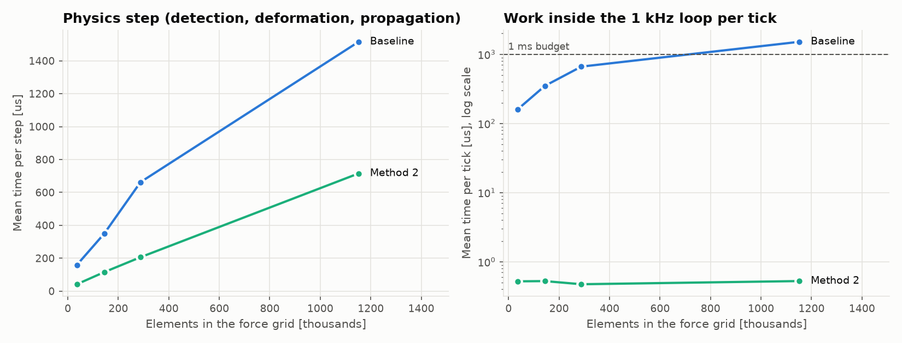

# Virtual Pottery

Mô phỏng tạo hình gốm ảo với phản hồi lực. Người dùng dùng stylus của thiết bị
haptic (Sensable PHANToM) hoặc chuột để làm biến dạng khối đất sét trên bàn xoay
và cảm nhận lực đẩy lại. Xây dựng trên **CHAI3D 3.3** và **GLFW**.

Khối đất được mô hình bằng các phần tử hình quạt tròn (Han 2007, Lee 2008), có
lan truyền lực phản hồi giữa các phần tử lân cận (Lee 2009).

## Hai phương pháp

Chương trình có hai phương pháp để so sánh, chuyển bằng nút **Baseline** /
**Method 2** ở góc trên bên phải, hoặc phím `0` / `2`.

| | Baseline | Method 2 |
|---|---|---|
| Lực tiếp xúc | trung bình độ ngập `(c_v/n) Σ pᵢfᵢ` | thể tích ngập `k_V Σ pᵢAᵢfᵢ` |
| Mô hình đầy đủ | 1 kHz, trong vòng servo | 250 Hz, luồng riêng + độ cứng cục bộ |
| Lan truyền | vỏ tứ giác (Lee 2009) | nhân chập tách được |
| Lọc lực | Butterworth 10 Hz | không cần |

### Method 2

- **Lực theo thể tích ngập:** `F = k_V · Σ pᵢ·Aᵢ·fᵢ`, với `Aᵢ = R·Δθ·Δh`. Phần tử
  mới chạm có `p ≈ 0` nên lực liên tục và gần như không phụ thuộc độ phân giải
  lưới. Ma sát tỷ lệ `μ|F_n|`; lực nhớt tỷ lệ diện tích tiếp xúc
  `−c2·min(1, A/A_ref)·v`. Mã: `CollisionResponder::contactForce`.
- **Độ cứng cục bộ đa tốc độ:** luồng physics chạy mô hình đầy đủ ở 250 Hz và
  tính `K = k_V Σ Aᵢ fᵢfᵢᵀ`. Vòng servo 1 kHz chỉ tính `F ≈ F₀ − K(x − x₀)`, có
  nội suy chéo giữa hai mô hình liên tiếp. Mã: `Haptic_Thread/LocalForceModel.*`.
- **Lan truyền tách được:** kernel `1/((c_l δ)²+1)` của Lee 2009 được thay bằng
  Gaussian cùng tổng trọng số, tính theo hàng rồi theo cột trong dải quanh vùng
  tiếp xúc. Mã: `CollisionResponder::propagateSeparable`.

## Chạy trong terminal của Visual Studio Code

Yêu cầu: Visual Studio 2026 (C++), CMake, CHAI3D 3.3 đã build, Python 3 với
`matplotlib` và `numpy` (chỉ cần cho phần vẽ đồ thị).

Mở thư mục `VirtualPottery_Project` trong VS Code, mở terminal
(`` Ctrl+` ``, PowerShell) rồi chạy:

```powershell
# 1. Cấu hình (chỉ lần đầu). Bỏ -Dchai3d_DIR nếu CMake tự tìm thấy CHAI3D.
cmake -S . -B build -G "Visual Studio 18 2026" -A x64 `
      -Dchai3d_DIR="C:/Users/Admin/Desktop/Project/chai3d/chai3d-3.3.0/out/build/Visual Studio Community 2026 Release - amd64"

# 2. Build
cmake --build build --config Release

# 3. Chạy
.\bin\win-x64\VirtualPottery.exe                # Method 2 (mặc định)
.\bin\win-x64\VirtualPottery.exe --method 0     # Baseline
.\bin\win-x64\VirtualPottery.exe --open         # khởi động với lòng đã mở

# 4. So sánh hai phương pháp (khoảng 1 phút, tự thoát), rồi vẽ đồ thị
.\bin\win-x64\VirtualPottery.exe --bench
python Evaluation\plot_comparison.py
```

Sau khi sửa code chỉ cần chạy lại bước 2 và 3.

## Điều khiển

Không có thiết bị haptic thì dùng chuột: dụng cụ đi theo con trỏ, con lăn chỉnh
độ sâu, giữ chuột phải để quay bàn.

| Phím | Chức năng |
|---|---|
| `0` · `2` (hoặc nút) | Baseline · Method 2 |
| `SPACE` · `↑` `↓` | quay bàn · tốc độ bàn |
| `[` `]` · `,` `.` | cỡ dụng cụ · độ phân giải lưới |
| `R` · `O` | đặt lại đất · mở/đóng lòng |
| `K` `V` `D` `C` (`SHIFT` để giảm) | độ cứng · độ nhớt · giảm chấn · ma sát |
| `P` · `W` | bật/tắt lan truyền · khung dây |
| `F` · `F1` · `Q` | toàn màn hình · bảng phím · thoát |

## Kết quả so sánh

`--bench` cho một dụng cụ chạy theo kịch bản qua toàn bộ hệ thống, 12 lượt: ấn
vào khi bàn dừng (như Hình 8, Lee 2008) và khoét rãnh khi bàn quay (như Lee 2009),
ở nhiều độ phân giải. Dữ liệu từng tick nằm trong `Results/*.csv`, bảng đầy đủ ở
[Results/summary.md](Results/summary.md).

| | Baseline | Method 2 |
|---|---|---|
| Bước nhảy lực lớn nhất trước lọc (rãnh 400×360) | 32,0 mN | 6,2 mN |
| Độ trễ do bộ lọc lực | 23 ms | 0 |
| Lực đỉnh thay đổi giữa lưới 200×180 và 800×360 | 5,0 % | 1,3 % |
| Bước physics, rãnh 400×360 | 349 µs | 115 µs |
| Bước physics, rãnh 1600×720 | 1515 µs | 715 µs |
| Thời gian trong vòng 1 kHz, 1600×720 (trung bình) | 1516 µs | 0,5 µs |
| Tần số servo thực tế, 1600×720 | 640 Hz | 1000 Hz |

Số liệu thời gian phụ thuộc máy và có thể thay đổi giữa các lần chạy.

| Hình | Nội dung |
|---|---|
|  | Lực, độ sâu, số phần tử va chạm khi ấn vào |
|  | 100 ms lực ở mức từng tick khi khoét rãnh |
|  | Bước nhảy lực lớn nhất giữa hai tick |
|  | Cùng một lượt ấn trên lưới thô và lưới mịn |
|  | Thời gian bước physics và thời gian trong vòng 1 kHz |

Lực đỉnh của Method 2 thấp hơn vì lực thể tích tăng theo bình phương độ sâu; có
thể chỉnh bằng phím `K`.

## Cấu trúc

```
VirtualPottery_Project/
├── Core_Data_Structures/   phần tử hình quạt, lưới, bàn xoay, cấu hình method
├── Haptic_Thread/          thiết bị haptic, phát hiện và phản hồi va chạm, mô hình lực cục bộ
├── Graphic_Thread/         đồng bộ dữ liệu lên GPU, vẽ cảnh và giao diện, shader
├── Evaluation/             benchmark và script vẽ đồ thị
├── Results/                CSV, hình, summary.md
└── main.cpp                ba luồng (servo 1 kHz, physics 250 Hz, đồ hoạ) và nhập liệu
```

## Giới hạn

- Chưa thử với PHANToM thật; các số liệu đo bằng dụng cụ theo kịch bản và chuột.
- CHAI3D 3.3 có lỗi xoá hai lần trong `~cViewport()`, nên viewport không được xoá
  khi thoát.
